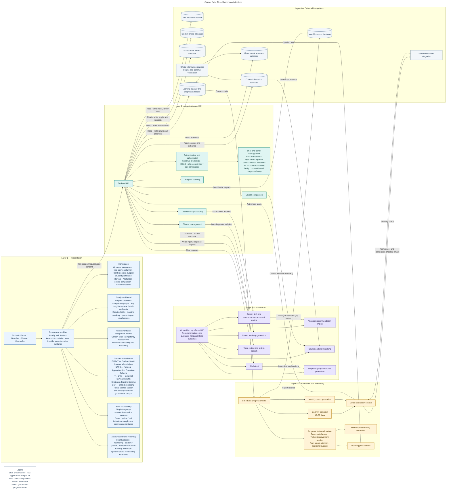

# Career Setu AI

*AI-Enabled Career Counselling and Family Decision-Support Platform for Vocational Education*

## System Architecture

## End-to-End User Workflow

```mermaid
---
title: Career Setu AI — End-to-End User Workflow
---
flowchart LR
    subgraph START["Registration and setup"]
        direction LR
        N1["1. Student registers<br/>on Career Setu AI"]
        N2["2. Creates profile<br/>Interests · education · location · goals"]
        N3["3. Optionally invites<br/>parent and mentor"]
        N4["4. Each user signs in<br/>separate credentials · linked family accounts<br/>role-scoped access · consent-based sharing"]
        N1 --> N2 --> N3 --> N4
    end

    subgraph ASSESS["Assess and recommend"]
        direction LR
        N5["5. Student completes<br/>career, skill, and competency assessments"]
        D1{"Assessment<br/>complete?"}
        N6["6. Assessment engine evaluates<br/>strengths and skill gaps"]
        N7["7. AI suggests careers,<br/>courses, and learning paths"]
        N8["8. Compare courses<br/>fees · duration · skills · eligibility · opportunities"]
        N9["9. Identify relevant opportunities<br/>training · apprenticeships · scholarships · self-employment"]
        N5 --> D1
        D1 -->|"No: complete remaining assessments"| N5
        D1 -->|"Yes"| N6 --> N7 --> N8 --> N9
    end

    subgraph DECIDE["Family decision and planning"]
        direction LR
        N10["10. Student and family review<br/>recommendations on Family Dashboard"]
        D2{"Counselling<br/>needed?"}
        N11["11. Mentor provides<br/>personalized counselling"]
        N12["12. Student follows<br/>Free Learning Planner and roadmap"]
        N10 --> D2
        D2 -->|"Yes"| N11 --> N12
        D2 -->|"No"| N12
    end

    subgraph MONITOR["Progress monitoring and follow-up"]
        direction LR
        N13["13. Track progress<br/>percentages · graphs · green / yellow / red status"]
        N14["14. Generate monthly reports<br/>for authorized users when due"]
        N15["15. Scheduled check<br/>inactivity 15–30 days or progress concern"]
        D4{"Inactive<br/>15–30 days?"}
        D3{"Sufficient<br/>progress?"}
        N16["16. Send Gmail alerts<br/>to relevant users, subject to preferences and permissions"]
        N17["17. Student resumes learning,<br/>gets support, and updates plan"]
        N18["18. Repeat progress-monitoring cycle"]
        N13 --> N14 --> N15 --> D4
        D4 -->|"Yes"| N16 --> N17 --> N18
        D4 -->|"No"| D3
        D3 -->|"Yes"| N18
        D3 -->|"No: support needed"| N16
        N18 --> N13
    end

    N4 --> N5
    N9 --> N10
    N12 --> N13

    LEGEND["Legend: rounded boxes = user or system action · diamonds = decisions<br/>Green = satisfactory · Yellow = improvement needed · Red = urgent attention / support"]
    classDef action fill:#eaf4ff,stroke:#2563a6,color:#17324d,stroke-width:1.5px
    classDef decision fill:#fff3d6,stroke:#c18b22,color:#553b08,stroke-width:1.5px
    classDef progress fill:#dff5f2,stroke:#168b83,color:#123d3a,stroke-width:1.5px
    classDef legend fill:#dff5f2,stroke:#168b83,color:#123d3a
    class N1,N2,N3,N4,N5,N6,N7,N8,N9,N10,N11,N12,N13,N14,N15,N16,N17,N18 action
    class D1,D2,D3,D4 decision
    class N13 progress
    class LEGEND legend
```

## Legend

- **Blue:** people-facing interfaces and workflow actions.
- **Teal:** application services and the legend callout.
- **Purple:** AI capabilities.
- **Slate:** databases and external information / email integrations.
- **Amber:** automation, monitoring, and decision points.
- **Progress status:** green = satisfactory, yellow = improvement needed, red = urgent attention or additional support.

See [`docs/README.md`](docs/README.md) for module explanations, data-flow notes, technology choices, and preview/export instructions.
